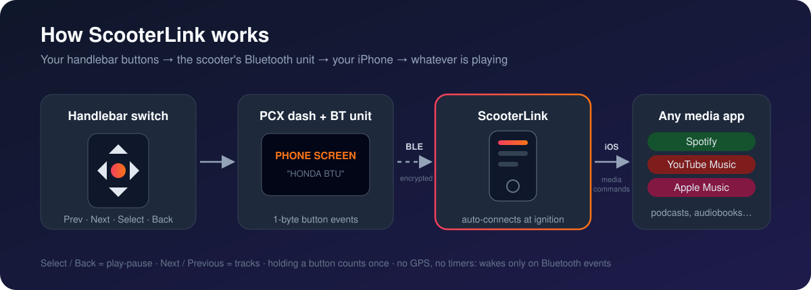
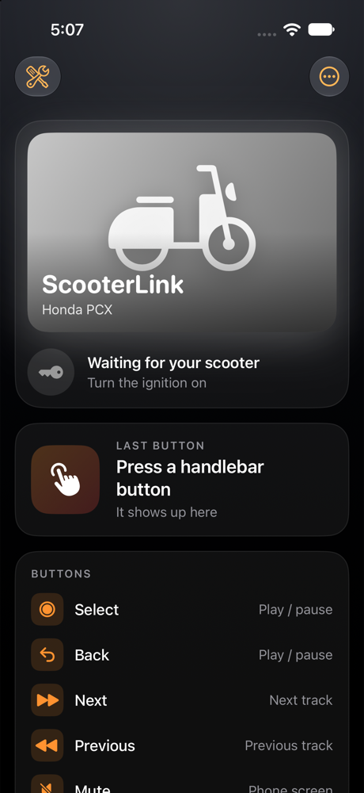
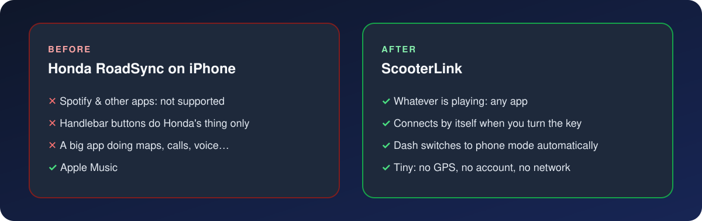
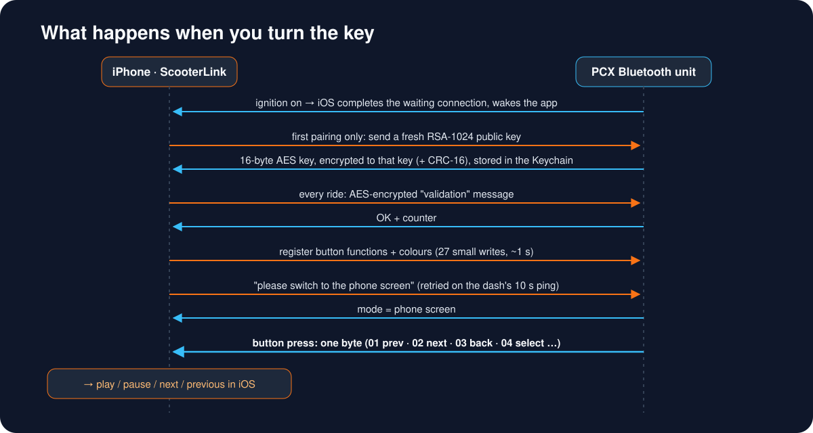

# ScooterLink

**Control *any* music app on your iPhone from the handlebar buttons of a Honda PCX (2025).**
Spotify, YouTube Music, podcasts, audiobooks… whatever is playing. No Honda app needed.



<p align="center"></p>

## Why this exists

Honda's RoadSync app is the official way to link a phone to the PCX dashboard. On iPhone its
music controls only work with **Apple Music**. If you live in Spotify, the nice handlebar
switch is useless for music. (iOS doesn't give apps a public way to control *other* apps'
playback, so Honda took the easy road.)

My previous scooter did play/pause/next for *whatever* was playing. This one couldn't.
So I reverse-engineered how the scooter talks to the phone and wrote a tiny replacement.



## What it does

| Handlebar button | Action |
|---|---|
| **Select** | play / pause |
| **Back** | play / pause |
| **Next** | next track |
| **Previous** | previous track |
| Mute (on the scooter's own screen) | bring the phone screen back |

- **Connects by itself.** Turn the key and iOS reconnects in the background. No need to open the app.
- **Switches the dash to phone mode automatically**, so the buttons are passed to the phone.
- **One press = one action.** Holding a button makes the dash auto-repeat; ScooterLink ignores the repeats.
- **Lean.** No GPS, no network, no account, no timers. It only wakes up when the scooter sends something over Bluetooth.

## How it works

The PCX dashboard has a Bluetooth Low Energy unit (it shows up as `HONDA BTU …`). The phone
talks to it with Honda's own little protocol. I worked it out by studying how the official
Android app talks to the scooter and by logging the traffic. Full write-up:
**[docs/PROTOCOL.md](docs/PROTOCOL.md)**.



1. **Pairing.** The first time, the phone sends a fresh RSA-1024 public key. The scooter answers
   with a random 16-byte AES key encrypted to it. ScooterLink keeps that key in the iOS Keychain.
2. **Every ride.** The phone proves it still has the key with one AES-encrypted message.
3. **Button setup.** The phone registers which button functions it wants (27 tiny writes).
4. **Phone screen.** The phone asks the dash to switch to "phone mode". In scooter mode the dash
   keeps most buttons for its own menus.
5. **Presses.** Every press arrives as a single byte (`01` previous, `02` next, `03` back,
   `04` select …). ScooterLink turns it into a system-wide media command, the same kind
   Control Center sends.

Honda limited it to one app. Now it controls any of them.

## Requirements

- Honda PCX 2025 with the TFT dash and RoadSync support. Tested on a PCX125 2025. Other
  RoadSync bikes probably speak the same protocol but are untested.
- An iPhone and a Mac with Xcode 16+ and [XcodeGen](https://github.com/yonaskolb/XcodeGen).
- An Apple developer account to sign it (a free one works, but the app then expires every 7 days).

This is a **sideload-only** app. It uses a private iOS framework (MediaRemote) for the
"control any app" part, so it can't go on the App Store.

## Install

```bash
git clone https://github.com/gdorgian/ScooterLink.git
cd ScooterLink/App
cp Config/Signing.example.xcconfig Config/Signing.xcconfig   # put your Team ID + a bundle ID in it
xcrun devicectl list devices                                  # find your iPhone's identifier
bash install-device.sh <your-iphone-identifier>
```

Then, at the scooter:

1. In the dash's Bluetooth menu, **delete RoadSync's phone pairing** (the scooter keeps one phone key at a time).
2. Turn the ignition on, open ScooterLink, go to **Devices → Scan**, and tap `HONDA BTU …`. Accept the iOS pairing prompt.
3. Done. From now on it connects by itself whenever you turn the key. Don't swipe the app away
   in the app switcher, because iOS won't relaunch an app you force-quit.

**Make it yours:** drop a photo of your own bike into `App/Sources/Assets.xcassets` as an image set
called `Logo` (shown on the home screen) and as the `AppIcon` (1024×1024). The folder is git-ignored,
so your photo never ends up in a commit.

## Known limits

- **AirPods noise control can't be switched.** iOS accepts the private call from an app and then
  ignores it. Nobody has made this work on a non-jailbroken iPhone.
- **No "now playing" text.** iOS hides the current track from third-party apps.
- **No speed from the scooter.** The PCX doesn't send it over Bluetooth.
- **Volume:** the PCX switch gear has no volume buttons.

## ⚠️ Be careful with the dash

While experimenting, I sent the dash **custom colour slots (IDs above 18) and a custom-drawn
screen**. After that the dash refused to show the phone screen at all, even across ignition
cycles. The fix was to **delete the pairing on the bike, forget `HONDA BTU` in iOS Bluetooth
settings, and pair again**.

That's why the screen-drawing and custom-colour code in this repo is switched **off**
(`Features` in `App/Sources/DashScreen.swift`). If you experiment, change one thing at a time,
and **never write to the firmware-update (DFU) service.**

## Project layout

```
App/
  Sources/SABProtocol.swift    UUIDs, button codes, button/colour registration
  Sources/SABCrypto.swift      RSA → AES key exchange, validation, CRC-16
  Sources/SABClient.swift      CoreBluetooth: auto-connect, handshake, phone screen, buttons
  Sources/ButtonActions.swift  button → system media command
  Sources/HomeView.swift       home screen: status, last button, button map
  Sources/DashScreen.swift     dash screen encoder (experimental, off)
  Tests/main.swift             crypto/encoder self-tests (swiftc, runs on a Mac)
docs/PROTOCOL.md               the protocol, as far as it's known
```

Run the self-tests on a Mac:

```bash
cd App && xcrun swiftc -o /tmp/sl-test Sources/SABCrypto.swift Sources/SABProtocol.swift Sources/DashScreen.swift Tests/main.swift && /tmp/sl-test
```

## Legal

ScooterLink is an independent project. It is **not affiliated with, endorsed by, or supported by
Honda**. "Honda", "PCX" and "RoadSync" are trademarks of their owners. This repository contains
**no Honda code or files**: only original code and a description of the Bluetooth messages,
written for interoperability. Use it at your own risk, and don't fiddle with your phone while riding.

## License

MIT. See [LICENSE](LICENSE).
